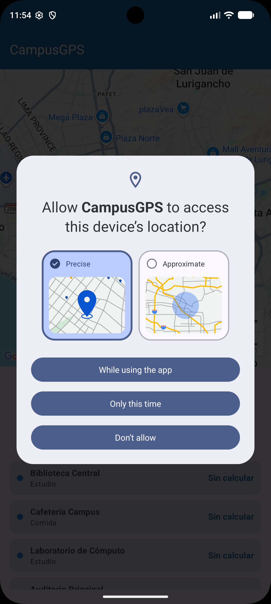
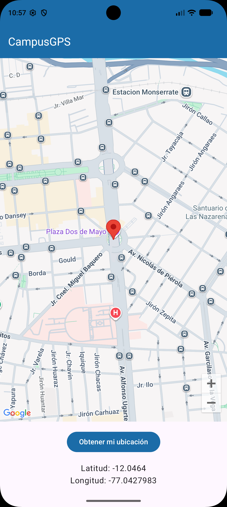
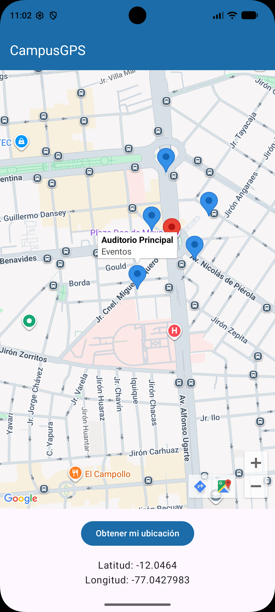
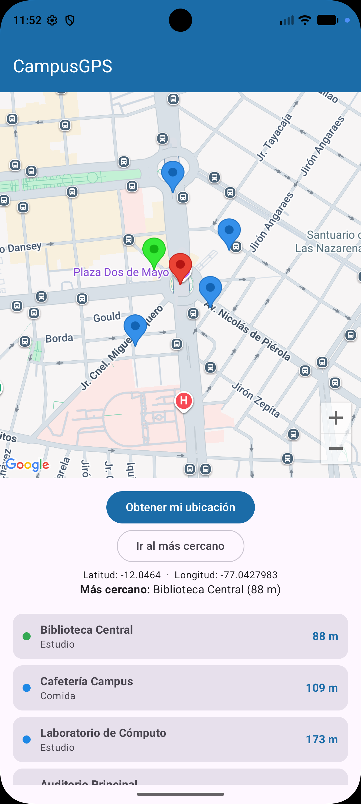
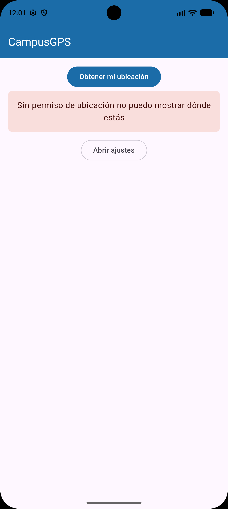

# CampusGPS

App Android que obtiene la ubicación del celular, la muestra en un mapa de Google y te dice qué lugar del campus tienes más cerca. Muestra 5 puntos ficticios (biblioteca, cafetería, laboratorio, auditorio y estacionamiento) con su distancia en metros, ordenados del más cercano al más lejano.

**Curso:** Programación en Móviles – Tecsup · **Laboratorio 13:** Localización geográfica
**Autor:** Guillermo Willard Castillo (trabajo individual)

## Tecnologías
- Kotlin + Jetpack Compose + Material 3 (sin XML)
- Google Play Services Location (`FusedLocationProviderClient`)
- Maps Compose (Google Maps SDK for Android)
- Arquitectura MVVM + Repository (interface)

## Cómo ejecutarlo
1. Clona el repositorio y ábrelo en Android Studio.
2. En Google Cloud habilita **Maps SDK for Android**, crea una clave de API y restríngela al paquete `com.tecsup.campusgps` y a tu huella SHA-1 (`./gradlew signingReport`).
3. Agrega la clave en `local.properties` (este archivo no se sube a GitHub):
   ```
   MAPS_API_KEY=tu_clave
   ```
4. Usa un emulador con Google Play y pon su ubicación en `-12.0464, -77.0428` (Extended controls → Location → Set location).

## Estructura de paquetes
```
com.tecsup.campusgps/
├── MainActivity.kt
├── model/
│   └── Modelos.kt                      Posicion, Lugar, LugarConDistancia, TipoError, UbicacionUi
├── data/
│   ├── UbicacionRepository.kt          interface + UbicacionNoDisponibleException
│   ├── UbicacionRepositoryGoogle.kt    implementación con FusedLocationProviderClient
│   ├── LugaresRepository.kt            interface
│   └── LugaresRepositoryLocal.kt       los 5 lugares ficticios
├── util/
│   ├── Distancia.kt                    distanciaMetros()
│   └── Formato.kt                      formatearDistancia()
├── viewmodel/
│   ├── MapaViewModel.kt
│   └── CampusViewModelFactory.kt
└── ui/
    ├── PantallaMapa.kt
    ├── MapaUbicacion.kt
    ├── ListaLugares.kt
    ├── MensajeError.kt
    └── theme/
```

## Arquitectura MVVM + Repository
```
View (PantallaMapa, MapaUbicacion, ListaLugares, MensajeError)
   │  evento: pulsar botón / tocar tarjeta          ▲ collectAsState()
   ▼                                                │
ViewModel (MapaViewModel) ──── StateFlow ───────────┘
   │  llama solo a las interfaces
   ▼
UbicacionRepository ──► UbicacionRepositoryGoogle (FusedLocationProviderClient)
LugaresRepository   ──► LugaresRepositoryLocal (5 lugares fijos)
```

| Capa | Conoce a | No hace |
|---|---|---|
| View (`ui/`) | Solo su ViewModel | No usa Repository ni calcula distancias |
| ViewModel | Solo las interfaces de Repository | No conoce Composables ni recibe `Context` |
| Repository | Google Play Services | No expone clases de UI |
| `util/` | Funciones puras | No guarda estado |

## Capturas

| Permiso | Mapa con mi ubicación | Marcadores |
|---|---|---|
|  |  |  |

| Lista ordenada y más cercano | Error |
|---|---|
|  |  |

## Para pensar

**1. ¿Por qué `FusedLocationProviderClient` está dentro del Repository y no en el ViewModel?**
Porque es un detalle de Google Play Services que necesita un `Context`. El ViewModel solo conoce la interface `UbicacionRepository`: así no recibe `Context`, se puede probar con un repositorio falso y la implementación se puede cambiar sin tocar el ViewModel.

**2. ¿Qué diferencia hay entre el permiso de ubicación y la clave de API de Maps? ¿Qué pasa si falta cada uno?**
El permiso lo da el usuario en Android y autoriza a la app a leer la ubicación. La clave la da Google Cloud e identifica a la app ante los servidores de Maps. Sin permiso, la app no obtiene la ubicación y muestra el mensaje con *Abrir ajustes*. Sin clave, el mapa sale gris (o la app se cierra si la clave está vacía), aunque la ubicación siga funcionando.

**3. ¿Por qué la clave va en `local.properties` y no en el código? ¿Qué harías si se subiera a GitHub por error?**
Porque `local.properties` está en `.gitignore` y no se sube; si estuviera en el código, cualquiera podría verla en GitHub y usarla. Si se filtrara, la borraría en Google Cloud, crearía una nueva restringida al paquete y a la SHA-1, y revisaría el `.gitignore`.

**4. ¿Dónde calculas la distancia y por qué no en el Composable?**
En `util/Distancia.kt`, llamada desde `actualizarDistancias()` del ViewModel cuando llega la ubicación. Un Composable se redibuja muchas veces y solo debe dibujar el estado que recibe; calcular ahí rompe MVVM y repetiría el cálculo en cada recomposición.

**5. ¿Qué pasa con tu app si el usuario niega el permiso dos veces? ¿Cómo lo manejas?**
Android deja de mostrar el cuadro de permiso y el lanzador devuelve "denegado" de inmediato. La app llama a `vm.permisoDenegado()` y muestra el error `SIN_PERMISO` con el botón *Abrir ajustes*, que lleva a la pantalla de la app en Ajustes para activar el permiso a mano.